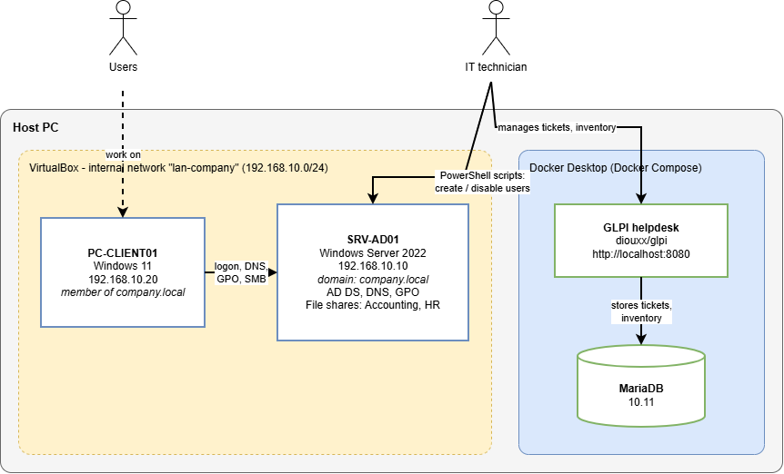
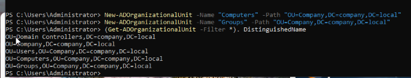
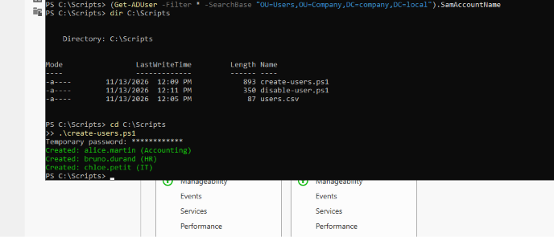
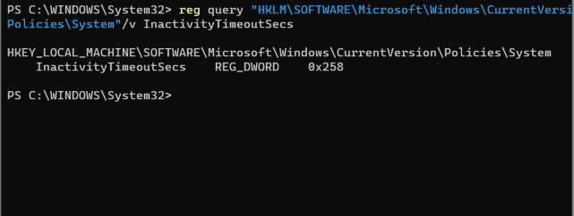
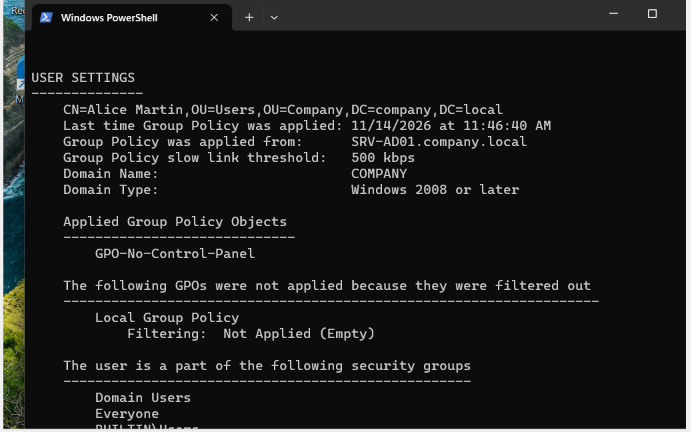
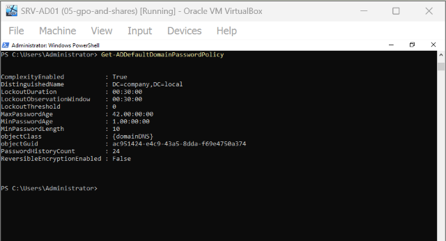
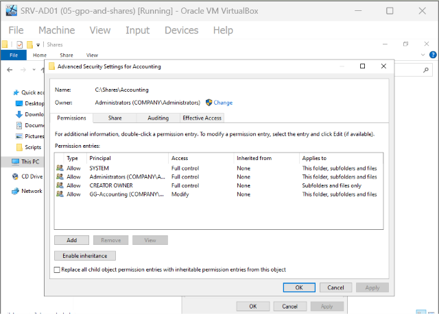
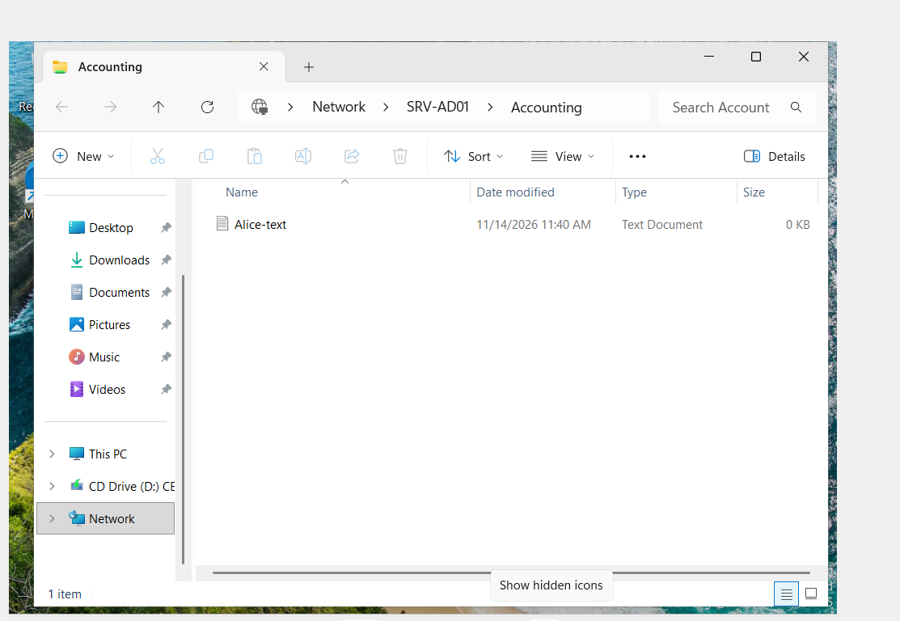
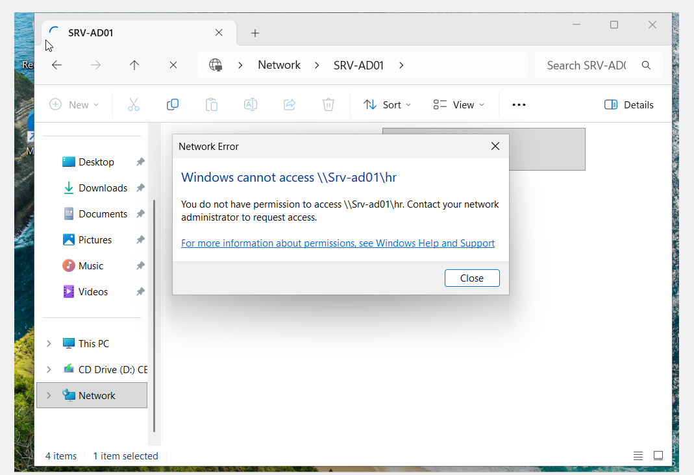

# Mini IT Service

A small company IT environment built from scratch in a virtual lab: Active Directory, Group Policy, file shares, PowerShell automation and a GLPI helpdesk.

**Status:** v1.0

## What this project shows

- Deploying a Windows Server 2022 domain controller (`company.local`) with DNS
- Organizing users with OUs and security groups (`GG-Accounting`, `GG-HR`, `GG-IT`)
- Automating user creation and offboarding with PowerShell and a CSV file
- Enforcing rules with Group Policy (screen lock, control panel restriction, password policy)
- Securing file shares with NTFS and share permissions
- Joining a Windows 11 client to the domain and testing access as a real user
- Running a helpdesk with GLPI (Docker): inventory, tickets, followups and solutions
- Writing clear knowledge base articles for the support team

## Architecture



| Machine | Role | IP |
|---|---|---|
| SRV-AD01 | Windows Server 2022: AD DS, DNS, file shares | 192.168.10.10 |
| PC-CLIENT01 | Windows 11 client joined to `company.local` | 192.168.10.20 |
| GLPI (Docker) | Helpdesk on `http://localhost:8080` with MariaDB | host PC |

The two virtual machines run in VirtualBox on an internal network named `lan-company`.

## Active Directory

- OUs: `Company > Users`, `Company > Computers`, `Company > Groups`
- Users: `alice.martin` (Accounting), `bruno.durand` (HR), `chloe.petit` (IT)
- Each user is a member of the global group of their department




## PowerShell scripts

| Script | What it does |
|---|---|
| `scripts/create-users.ps1` | Creates the users listed in `scripts/users.csv`, adds them to their department group, skips existing accounts |
| `scripts/disable-user.ps1` | Disables an account and removes it from all groups. Shows a red error if the login does not exist |

```powershell
.\create-users.ps1
.\disable-user.ps1 -Login bruno.durand
```

## Group Policy

| GPO | Linked to | Effect |
|---|---|---|
| GPO-Screen-Lock | Computers OU | Locks the session after 600 seconds of inactivity |
| GPO-No-Control-Panel | Users OU | Blocks access to the Control Panel |
| Default Domain Policy | Domain | Minimum password length of 10 characters, complexity enabled |

Proof of application on the client:





## File shares and permissions

Two shares, `Accounting` and `HR`. Inheritance is disabled on each folder, and only the matching group, Administrators and SYSTEM have access. When share and NTFS permissions differ, the most restrictive one applies.



Test as `alice.martin` (Accounting): she opens the Accounting share and is denied on HR.




## GLPI helpdesk

GLPI runs with Docker Compose (`glpi/docker-compose.yml`). Passwords are stored in a local `.env` file that is not published. Use `glpi/.env.example` as a template.

Work done in GLPI:
- Default demo accounts removed and administrator password changed
-